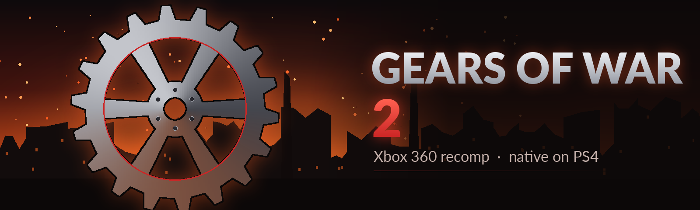

<p align="center">
  
</p>

<p align="center">
  <a href="https://github.com/iHaiDeeZ/Gears-of-War-2-PS4/releases/latest"></a>
  
  
  
  <a href="LICENSE"></a>
  <a href="https://discord.gg/fqjMs9gDJh"></a>
</p>

<h3 align="center">Gears of War 2, recompiled to run natively on the PS4.</h3>

<p align="center">
  <a href="#getting-started"><b>🛠 Build it yourself</b></a> ·
  <a href="#getting-started">Getting started</a> ·
  <a href="#controls">Controls</a> ·
  <a href="#the-quick-menu">Quick menu</a> ·
  <a href="#faq">FAQ</a> ·
  <a href="https://discord.gg/fqjMs9gDJh">Discord</a> ·
  <a href="CREDITS.md">Credits</a>
</p>

---

## Overview

This port brings [gears-of-war-2-pc-port](https://github.com/santiquiroz/gears-of-war-2-pc-port), santiquiroz's
recompilation of **Gears of War 2** (Epic Games and Microsoft, 2008), to jailbroken PS4 consoles. There's no CPU
emulator: [ReXGlue](https://github.com/rexglue/rexglue-sdk) turns the PowerPC code of the game's `default.xex` into
C++ on your PC, and that code is compiled for the PS4's Jaguar CPU. The game's Xbox 360 GPU commands are drawn by the
SDK's Xenos layer (derived from [Xenia](https://xenia.jp)) on **Vulkan**, through Mesa's RADV driver adapted to the
PS4's AMD GPU.

The runtime is the PS4 SDK of [Vigilante-8-Arcade-PS4](https://github.com/iHaiDeeZ/Vigilante-8-Arcade-PS4) (the ReXGlue
SDK with the [MP3-PS4](https://github.com/iHaiDeeZ/MP3-PS4) platform layer), with this game's changes on top, and the
native versions of the game's busiest functions come from [gears2-nx](https://github.com/VasilkovND/gears2-nx), the
Switch port.

It installs as an app on the home screen and plays with a DualShock 4. **L3 + R3** opens a quick menu with the
graphics options, a frame counter, the achievements and the diagnostics.

**You bring your own game.** Nothing copyrighted is in this repository: no game code, art or sound, and no packages.
The package you build holds code made from your game (and, if you choose, the game itself), so it's for your own
console only.

## Highlights

**The whole game, natively**
- The game's PowerPC code recompiled ahead of time and built for the PS4's Jaguar cores: no interpreter, no JIT.
- The PC port's fixes, and xenia-canary's game patches as switches: the Black Shading Fix, the Texture Streaming
  Fix, 16x anisotropic filtering, the AO and depth of field fixes, and the frame rate unlock.
- Speed passes on the generated code (from mp3-nx and MP3-PS4): guest registers as C++ locals, small helpers inlined,
  fused multiply-adds split for the Jaguar (it has no FMA unit).
- **Native game functions** (from gears2-nx): memory copies, Unreal's name lookups, bone matrices, the LZX
  decompression of packages and streamed textures, and the D3D runtime's shader constant uploads run as PS4 code.
- Sound at 48 kHz, with the game's XMA audio decoded by FFmpeg.
- **Achievements**: the quick menu lists them, a pop-up shows each unlock, and the game's own *Achievements* item
  opens that list. They're kept on the console.

**Made for the PS4's CPU**
- **No shader hitches.** A new GPU pipeline is compiled on worker threads while the game goes on: a new effect can
  appear a few frames late the first time, but the game never stops for it. Compiled shaders are kept, so the next
  start has them at once.
- **The 3D scene drawn once.** The original draws its scene with MSAA in tiles; here it's drawn once with FXAA, and
  Unreal's depth pre-pass (a quarter of the draws in fights) is left out.
- **Frame rate unlocked**, up to 60, with **v-sync** (no tearing) and the game's vblank following the TV's own.
- **The repeat-draw shortcut (v00.07):** three in four draws in busy views only change their shader constants from
  the draw before, so the GPU layer reuses that draw's shaders, pipeline, viewport, samplers and texture sets. It
  checks itself against the full work at the start of every session and switches itself off if anything differs.
- The game's own detail settings in the menu: world detail, character and effects detail, shadows, motion blur.
- The hot code laid out together: the functions a busy frame runs are linked side by side.

**When something goes wrong**
- A log for every session, ps4-kit's boot trace and crash log in `/data/GOW2/`.
- Diagnostics you can switch off in the menu: a freeze report with every thread's stack, a log of the game's long
  waits, a memory log, CPU profiles (one starts by itself on the first slow stretch of busy gameplay), and the GPU
  driver's flight recorder for GPU crashes.

## Status

| | |
|---|---|
| Boots, menus, campaign | yes (played through Act 1's opening chapters) |
| Frame rate | on a PS4 Pro in Boost Mode: quiet places 40-60 fps, busy ones 22-39 (v00.06); heavy fights are limited by the game's own logic thread, draw-heavy views by the GPU layer |
| Hitches | none from shaders since v00.02 |
| Picture | right; v-sync since v00.05, motion blur off by default since v00.06 |
| Achievements | yes, in the quick menu |
| Split-screen, online | not tested |
| Base PS4 | not tested (expect about a quarter slower where the CPU is the limit) |
| Tested on | a PS4 Pro on firmware 14.00 with GoldHEN |

## Getting started

**You need:** a jailbroken PS4 with **GoldHEN** and an FTP connection to it; a PC with **WSL 2** (Ubuntu, 16 GB of
RAM, about 30 GB free); and your **own** copy of **Gears of War 2** for Xbox 360: a disc image you made from your
disc.

Its `default.xex` must have SHA-1 `b6860bf31e55013467b53eca963d12314c0d78da` (title `4D53082D`, version 0.0.0.5, the
US retail disc, without a title update): the code generator's configuration is made for that file. Other releases
aren't tested.

> **Note:** the build also needs **[ps4-kit](https://github.com/iHaiDeeZ/ps4-kit)** in `~/ps4-kit`, the shared PS4
> base of these ports (toolchain setup, runtime, Mesa RADV for the PS4, VideoOut swapchain, packaging). Two of the
> Mesa patches this port was built with aren't in the published kit
> ([`79d173b`](https://github.com/iHaiDeeZ/ps4-kit/commit/79d173b)) yet, so they're in
> [`patches/mesa/`](patches/mesa): copy them into `~/ps4-kit/gpu/mesa-patches/` and build the kit's Mesa
> (`bash ~/ps4-kit/gpu/build-mesa.sh`) before the app.

### Building the package

1. Install the host tools in WSL (clang 21 from [apt.llvm.org](https://apt.llvm.org) if your Ubuntu doesn't have it):

   ```bash
   sudo apt install clang-21 lld-21 cmake ninja-build git rsync curl patch python3 python3-pil
   ```

2. Get the sources at the commits this port is built on, with its patches applied (into `~/gow2-build/src`):

   ```bash
   bash scripts/clone-gow2.sh
   ```

3. Unpack your disc image with [xdvdfs](https://github.com/antangelo/xdvdfs) (its release binaries, or
   `cargo install xdvdfs-cli`) and check the executable:

   ```bash
   xdvdfs unpack "<your disc image>.iso" ~/gow2-build/sd/game
   ln -sfn ~/gow2-build/sd/game ~/gow2-build/game
   sha1sum ~/gow2-build/game/default.xex
   ```

4. Build, from this repository's folder in WSL:

   ```bash
   scripts/build-gow2.sh host
   scripts/build-gow2.sh codegen
   GOW2_VERSION=00.07 scripts/build-gow2.sh app
   GOW2_VERSION=00.07 GOW2_PKG_GAME=1 scripts/build-gow2.sh pkg
   ```

   `host` builds the code generator (once), `codegen` writes the game's C++ from your `default.xex` (and applies the
   PC port's fixes and the speed passes), `app` compiles the eboot (about 1.5 GB of RAM per compile job) and `pkg`
   makes **`out/GOW2-v00.07-full.pkg`** (title ID `GEAR00002`, about 6.4 GiB with your game inside).

   Without `GOW2_PKG_GAME=1` you get `out/GOW2-v00.07.pkg` (about 120 MB, the app alone), and the app reads the game
   from `/data/GOW2/game`: upload it there once from Windows with `py scripts/upload-game.py --host <your PS4's IP>`.
   That's quicker for trying new versions.

5. Copy the package to the console (FTP to `/data/pkg`) and install it with GoldHEN's **Package Installer**. From
   Windows' Git Bash, `scripts/upload-full.sh out/GOW2-v00.07-full.pkg <your PS4's IP>` sends a package of 4 GiB or
   more and checks it arrived whole.

> **Tip:** the package's icon and background are original art (`scripts/make-icon.py`). To use your own, put a
> 512x512 `icon0.png` and a 1920x1080 `pic1.png` in `sce_sys/local/`: the build takes them from there, and git leaves
> them out.

**Updating:** build the newer version and install it on top of the old one. Your saves, achievements and settings in
`/data/GOW2/` stay.

## Controls

| DualShock 4 | Xbox 360 controller |
|---|---|
| Cross / Circle / Square / Triangle | A / B / X / Y |
| L1 / R1 | LB / RB |
| L2 / R2 | Left / right trigger |
| OPTIONS | Start |
| Touch pad click | Back |
| Left / right stick | Left / right stick |
| L3 / R3 | Stick buttons |
| D-pad | D-pad |
| **L3 + R3** | Open or close the quick menu |

## The quick menu

**L3 + R3** together while playing (again, or **Circle**, to close it). A panel slides in from the left. **L1 / R1**
change the tab, the D-pad moves, **Left / Right** change a setting and **Cross** picks. Changes apply at once, except
the ones marked "next start", and are saved to `/data/GOW2/gow2.toml` when the menu closes. The game keeps running
behind the menu, with your pad held back from it: pause with **OPTIONS** first.

| Tab | Row | Choices |
|---|---|---|
| GAME | Anti-aliasing | **FXAA** (the scene drawn once), Off, Original MSAA (in tiles, far slower; next start) |
| | Frame rate | 30 fps (original), **Unlocked** (up to 60) |
| | V-sync | **On** (no tearing), Off (tearing) |
| | Depth pre-pass | **Off** (faster, the same picture), On (the original; next start) |
| | World detail | **High** (original), Medium, Low: fewer decorative objects and decals, for what loads after the change |
| | Character detail | **Full** (original), Reduced, Low: simpler character models and fewer animated bones |
| | Effects detail | **Full** (original), Reduced, Low: simpler particle effects |
| | Dynamic shadows | **On** (original), Off |
| | Motion blur | On (original), **Off** (sharper) |
| | Native game functions | **On** (faster), Off (the recompiled code, to compare) |
| | Texture streaming fix, 16x anisotropic filtering, Ambient occlusion fix, Depth of field fix | **On**, Off (next start) |
| | Occlusion queries | **Fixed** (every object reported visible), GPU queries (slow; next start) |
| | New shaders | **Draw when ready** (no hitches), Wait for them (next start) |
| | Frame pacing | **Flip when ready**, Wait for the 60 Hz tick |
| | GPU shortcuts | **On**, Off: to check whether a picture problem comes from them |
| | Repeat-draw shortcut | **On**, Off (full work): to compare |
| OVERLAY | Frame counter | **Off**, FPS, Detailed (frame times and a graph of the last 120 frames) |
| | Position | **Top left**, Top right |
| DIAGNOSTICS | Record a CPU profile | 8 s of play after the menu closes, every thread, to `/data/GOW2/profiles/` |
| | Profile slow gameplay | **On**: once a session, after 10 s in a row under 32 fps in busy gameplay, an 8 s profile and a GPU census |
| | Freeze report | **On**: every thread's stack to `hang.log` when no frame comes for 15 s |
| | Frame rate log | **On**: the frame rate in the log every 10 s |
| | Memory log | **On**: the free system memory and the game's live objects in the log every 10 s |
| | Long-wait log | **On**: every 30 s, the game threads that have waited 2 s or more |
| | GPU fault recorder | **Off**, On: the GPU driver keeps the last frames' commands, for a GPU crash report (slower; next start) |
| ACHIEVEMENTS | Unlocked, Unlock pop-ups, Test pop-up, the list | your achievements; pop-ups **On** |
| ABOUT | | the build, the game, the CPU clock, the console |

The defaults are in bold.

## Your files

Everything sits in **`/data/GOW2/`**:

- `gow2/4D53082D/`, `gow2/B13EBABEBABEBABE/`: the Xbox 360 profile and your saves
- `gow2/achievements/`: your unlocked achievements
- `gow2/cache/`: the translated shaders; `cache/mesa/`: the GPU driver's compiled shaders
- `gow2.toml`: the settings (the quick menu writes it)
- `logs/gow2_NNN.log`: one log for every session
- `boot-trace.log`, `crash.log`, `hang.log`: ps4-kit's start-up trace, its crash record and the freeze report
- `profiles/`: the CPU profiles and GPU censuses
- `game/`: your unpacked game, only if your package doesn't carry it

## FAQ

**Why isn't there a package to download?**
The package holds code recompiled from the game (and, built with `GOW2_PKG_GAME=1`, the game's own files). You build
it from your own copy; this repository is source only.

**Which version of the game works?**
The Xbox 360 retail disc with the `default.xex` named above, without a title update.

**Why does it slow down in busy places?**
Two things set the frame rate. In fights the game's own logic (AI, animation) runs on one CPU core, converted from
PowerPC code. In views with many objects, the Xbox 360's GPU commands are translated for Vulkan on one CPU core, one
draw at a time, so the frame rate follows the number of draws. What helps: on a PS4 Pro, **Boost Mode** (Settings >
System: a 2.13 GHz CPU instead of 1.6); *World detail* Medium or Low and *Character detail* Reduced in the quick menu;
and keeping the *Depth pre-pass* off.

**With an unlocked frame rate the motion isn't smooth.**
With v-sync, a frame stays on screen for one or two refreshes of the TV, so 40-50 fps alternates between the two.
*Frame rate: 30 fps* gives each frame exactly two refreshes wherever the game keeps up.

**The picture tore or looked smeared in older versions.**
Up to v00.04 frames were shown mid-refresh (tearing); v00.05 waits for the TV's refresh. The game's own motion blur
smears the picture in a roadie run; it's off by default since v00.06 (*Motion blur* in the quick menu).

**Some surfaces went black when I switched motion blur off.**
That was v00.05: the engine settings were written 4 bytes off, and that option switched off the lightmaps instead.
v00.06 fixed every setting.

**How do I report a bug?**
On [Discord](https://discord.gg/fqjMs9gDJh) or in an [issue](https://github.com/iHaiDeeZ/Gears-of-War-2-PS4/issues).
Attach the newest `logs/gow2_NNN.log`, `boot-trace.log` and, if there are any, `crash.log`, `hang.log` and the files
in `profiles/` from `/data/GOW2/`, with the version, what you were doing, your PS4 model and firmware.

## How it works on the PS4

| Part | PS4 |
|---|---|
| Game code | ReXGlue v0.10.0's generator writes C++ from `default.xex` on your PC with the PC port's manifest and fixes; the PS4 passes speed it up; ps4-kit's clang 21 builds it for the Jaguar, the hot functions linked together |
| Runtime | the PS4 SDK of Vigilante-8-Arcade-PS4: the 360 kernel and XAM on PS4 threads, direct memory and files |
| GPU | the SDK's Xenos command processor (Xenia's design) translates the game's command ring into Vulkan, on ps4-kit's RADV and VideoOut |
| Shaders | Xenos microcode translated to SPIR-V as the game loads it; pipelines compiled on worker threads and kept, with RADV's own cache |
| Sound | XMA decoded by FFmpeg, out through `sceAudioOut` at 48 kHz |
| Pad | `scePad` (DualShock 4); the same pad drives the menu through ImGui |
| Files | the game read from the package (`/app0/game`) or `/data/GOW2/game`; saves in `/data/GOW2/gow2` |

Findings on the way that matter for other ports of this SDK (the whole story is in
[docs/DEVELOPMENT.md](docs/DEVELOPMENT.md)):

- **Pipeline hitches.** The SDK's asynchronous pipeline path still compiled a placeholder on the command thread for
  every new pipeline and waited for the creation queue at each submission. Draws whose pipeline isn't ready are now
  left out until it is, the creation threads run below the game's, and RADV's disk cache is switched on.
- **Tearing.** The SDK's presenter asks for Vulkan's IMMEDIATE mode, which the PS4's VideoOut flips mid-scan, and
  the guest's vblank came from a 60.00 Hz clock beside the TV's 59.94 Hz. Flips now wait for the vblank, and the
  guest's vblanks come from the display's.
- **Repeat draws.** Most draws in a busy 360 frame differ from the draw before only in shader constants; the command
  processor now reuses that draw's state, with a check against the full work.
- **Decompiled engine settings.** Unreal's `GSystemSettings` keeps a vtable pointer before its fields: offsets read
  from the settings loader are from the data, 4 bytes in.

## Good to know

- The repeat-draw shortcut checks itself at the start of every session; the log says
  `[repeat] the first 200000 repeat draws matched` when it's on, or which part differed if it switched itself off.
- The game keeps running while the quick menu is open.
- Save in the game; there are no save states. Your saves carry over to new versions.
- On a PS4 Pro, use Boost Mode. The app can't switch on the Pro's own mode (the Mesa driver knows only the base GPU),
  so the Pro's extra speed comes from Boost Mode.

## Community

Join the **[Discord](https://discord.gg/fqjMs9gDJh)** for help, reports and news.

## Thanks

- **[santiquiroz](https://github.com/santiquiroz/gears-of-war-2-pc-port)**: gears-of-war-2-pc-port, the recompilation
  of Gears of War 2 this port builds on
- **[VasilkovND](https://github.com/VasilkovND/gears2-nx)**: gears2-nx, whose native functions this port rewrites,
  and the code generation passes of mp3-nx
- **[ReXGlue](https://github.com/rexglue/rexglue-sdk)** by Tom Clay, with portions from **[Xenia](https://xenia.jp)**:
  the static recompiler and the Xbox 360 runtime, and **[rexglue-sdk-nx](https://github.com/nx-mod/rexglue-sdk-nx)**
- **[xenia-canary](https://github.com/xenia-canary/xenia-canary)**: the game patches the PC port carries
- **[Mesa](https://mesa3d.org)**: the RADV Vulkan driver that draws every frame
- **[FFmpeg](https://ffmpeg.org)** and **[libmspack](https://www.cabextract.org.uk/libmspack/)**: the XMA and LZX decoders
- **[Lato](https://www.latofonts.com)** by Łukasz Dziedzic: the quick menu's font
- **[OpenOrbis](https://github.com/OpenOrbis)** and **[PacBrew](https://github.com/PacBrew)**: the PS4 toolchains
- **GoldHEN**: the homebrew enabler the package runs under

Everyone involved, with licences, is listed in **[CREDITS.md](CREDITS.md)**. How the port is built and what it
changes: **[docs/DEVELOPMENT.md](docs/DEVELOPMENT.md)**.

## License and disclaimer

This repository is released under the **GNU GPL v3**, as the code generation passes and the native functions it
carries are. See [LICENSE](LICENSE). The upstream files the patches change keep their own licences (BSD-3-Clause for
the PC port and the ReXGlue SDK); see [CREDITS.md](CREDITS.md).

This is a fan-made project with no ties to Epic Games, Microsoft, Xbox Game Studios, Sony Interactive Entertainment or
the authors of the projects it builds on. Gears of War belongs to its owners; Xbox 360 is a trademark of Microsoft;
PlayStation and PS4 are trademarks of Sony Interactive Entertainment. Please only play games you own. This project
won't help you find or share game files.
